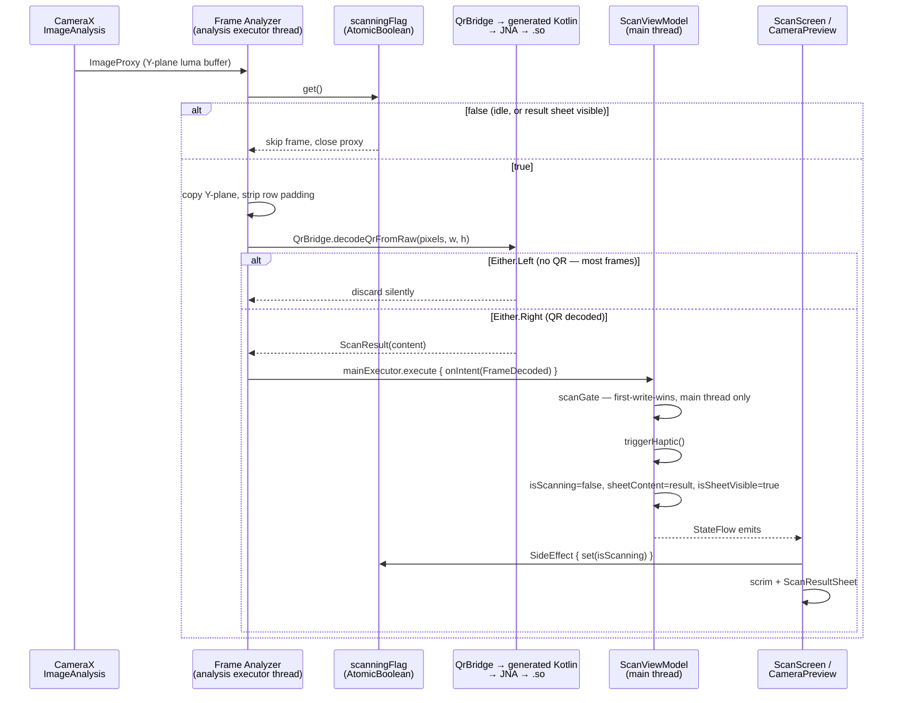
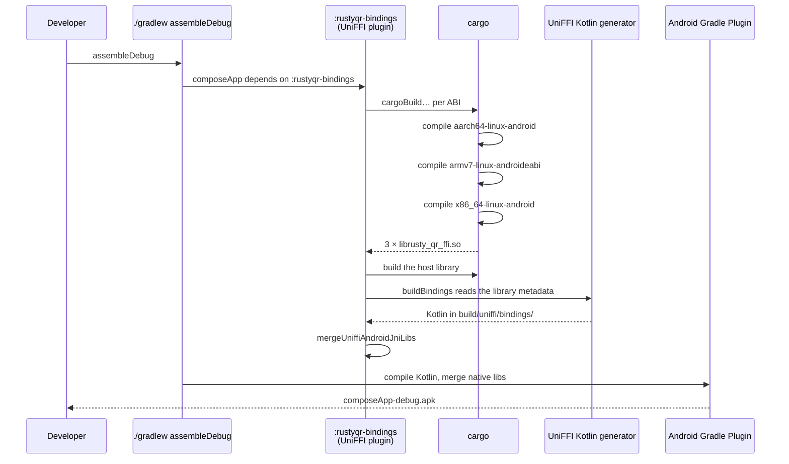
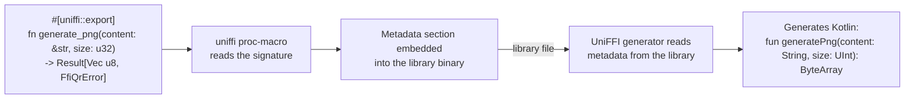

<div align="center">

# androidMain — Android Actuals & Build Pipeline

### CameraX scanner. Rust loaded as native <code>.so</code> via JNA. Single-activity Compose host.

<p>
  
  
  
  
  
</p>

<p><b>Rust <code>.so</code> × 3 ABIs · UniFFI Kotlin · CameraX Y-plane path · 16KB page-aligned</b></p>

<sub>This source set holds Android-specific <code>actual</code> implementations for the expect
declarations in <code>commonMain</code> plus the single-activity Compose host. The shared Compose
UI itself lives in <code>commonMain</code>.</sub>

</div>

---

> **Want the full pipeline end-to-end with sequence diagrams?**
> See [**`docs/ARCHITECTURE.md`**](../../../docs/ARCHITECTURE.md) — the single source of truth for
> how Rust becomes two native apps (both Android and iOS branches, runtime call paths, UniFFI deep
> dive).
>
> For shared KMM conventions (MVI, `bridge/` expect/actual, source set layout), see the
> [module README](../../README.md). For the top-level project pitch, see the
> [root README](../../../README.md). The iOS side is in
> [`iosApp/README.md`](../../../iosApp/README.md); the Rust engine is in
> [`rustySDK/README.md`](../../../rustySDK/README.md).

---

## Quick Start

```bash
# First-time setup — verifies JDK, Android SDK/NDK and the Rust toolchain with the
# Android Rust targets; prompts to install what's missing
./scripts/bootstrap.sh

# Gradle must find the Android SDK: export ANDROID_HOME (or set sdk.dir in local.properties)
export ANDROID_HOME="$HOME/Library/Android/sdk"

# Build Rust for 3 ABIs + generate the Kotlin bindings + build the APK
./gradlew :composeApp:assembleDebug
```

The first build compiles the UniFFI Kotlin generator with `cargo install`, which takes several
minutes; later builds reuse it. If you're only editing Kotlin / UI, run the same command again:
Gradle sees that the Rust sources and bindings are up to date and skips them.

> **Upgrading an old checkout?** The previous build pipeline wrote
> `composeApp/src/androidMain/jniLibs/` and `composeApp/src/androidMain/kotlin/generated/`.
> Gradle would package and compile them next to the new output, so delete both directories if
> they exist.

---

## Android-Specific Gradle Tasks

| Task                                          | What it does                                                          |
|-----------------------------------------------|-----------------------------------------------------------------------|
| `:composeApp:assembleDebug`                   | Debug APK; builds Rust (3 ABIs) and the bindings first               |
| `:composeApp:installDebug`                    | Install debug APK to connected device / emulator                      |
| `:rustyqr-bindings:buildBindings`             | Generate the Kotlin bindings only                                     |
| `:rustyqr-bindings:mergeUniffiAndroidJniLibs` | Collect the `.so` files per ABI                                       |

Build options:

- **Release:** `./gradlew :composeApp:assembleRelease -PreleaseBuild=true`. Without the flag,
  `verifyReleaseRustProfile` fails the build, so a shipped APK can never embed the debug Rust library.
- **NDK:** by default the plugin uses the newest NDK under `<sdk>/ndk`. Pin one with
  `-PndkVersion=<version>`.
- **ABIs:** debug builds cover `arm64-v8a`, `armeabi-v7a` and `x86_64`, from `androidAbis` in
  `gradle.properties`. Passing fewer (`-PandroidAbis=arm64-v8a`) builds faster, but only devices of
  that ABI can run the result.

Module-level linting and format tasks (ktlint, detekt, lintAll, installGitHooks) live on the parent
`composeApp` module — see the [module README](../../README.md).

---

<details>
<summary><b>Android Source Set Layout</b> — where actuals, JNI libs, and generated bindings live</summary>

<br/>

```
composeApp/src/androidMain/
├── kotlin/com/p2/apps/rustyqr/
│   ├── MainActivity.kt                 # Single-activity host — sets Compose content + MainActivityHolder
│   ├── MainActivityHolder.kt           # Weak-ref holder so bridges reach the foreground Activity
│   ├── RustyQrApplication.kt           # Application subclass — seeds AppContextHolder
│   ├── AppContextHolder.kt             # Static Application context for bridges (permissions, share, save)
│   ├── Platform.android.kt             # Platform() actual
│   └── bridge/
│       ├── CameraPreview.android.kt    # actual — CameraX PreviewView + ImageAnalysis
│       ├── CameraPermission.android.kt # actual — ActivityResultLauncher
│       ├── HapticFeedback.android.kt   # actual — HapticFeedbackType via View
│       ├── OpenUrl.android.kt          # actual — Intent(ACTION_VIEW)
│       ├── PlainTextClipEntry.android.kt # actual — ClipEntry for plain text
│       ├── ShareQrImage.android.kt     # actual — Intent(ACTION_SEND) via FileProvider
│       ├── SaveQrImage.android.kt      # actual — MediaStore.Images
│       └── ImageDecoder.android.kt     # actual — BitmapFactory → ImageBitmap
│
├── res/xml/                            # FileProvider paths, adaptive icon, etc.
└── AndroidManifest.xml                 # Permissions, activity, application class
```

There is no `jniLibs/` and no generated Kotlin in this source set. The `.so` files and the UniFFI
bindings belong to the `:rustyqr-bindings` module, which `composeApp` depends on:

```
rustyqr-bindings/build/                 # gitignored — regenerated by Gradle
├── uniffi/bindings/commonMain/…        # generated Kotlin API (expect declarations, data classes)
├── uniffi/bindings/androidMain/…       # generated actuals that call the .so through JNA
└── generated/jniLibs/mergeUniffiAndroidJniLibs/<abi>/librusty_qr_ffi.so
```

`QrBridge` is not an `expect`/`actual` pair, so there is no `QrBridge.android.kt`. It is one
`commonMain` object over the generated API.

The Android app has no Compose screens of its own — it reuses the shared `commonMain` screens from
the KMP module. The only Android-specific Compose code is inside the `bridge/` actuals (e.g.
`AndroidView` wrapping `PreviewView`).

</details>

<details>
<summary><b>Scan Feature — Data Flow on Android</b> — CameraX → scanning flag → Rust → MVI</summary>

<br/>



Key design decisions on Android:

- **Two flags, two jobs.** The analyzer reads `scanningFlag`, an `AtomicBoolean` that
  `CameraPreview.android.kt` writes in a `SideEffect` from its `isScanning` parameter (the screen's
  `ScanScreenState.isScanning`). It is written on the main thread and read on the analysis
  executor's thread, hence atomic. Separately, `ScanViewModel.scanGate` is a plain `Boolean` that
  is read and written only on the main thread. It is the first-write-wins guard that keeps a
  second `FrameDecoded`, already posted to the main thread before the state change reaches the
  analyzer, from reopening the sheet.
- **Camera session binds only while the user is actively scanning** — `CameraPreview` is gated on
  `isCameraActive`. On decode the analyzer stops decoding frames once `scanningFlag` turns false
  (the camera remains bound while the result sheet is open); on dismiss the screen returns to idle
  and the camera unbinds. The Scan tab opens cold with no preview and no permission prompt until
  Start Scanning.
- **`Either.Left` frames are silently discarded** — most frames contain no QR; this is the expected
  case, not an error path.
- **JNA is the loader** — the generated Android actual calls into `librusty_qr_ffi.so` through the
  `net.java.dev.jna` runtime library, not `System.loadLibrary`. JNA arrives as a dependency of the
  UniFFI plugin's runtime, so `composeApp` declares nothing for it.

</details>

<details>
<summary><b>Android Build Pipeline</b> — from Rust source to installable APK</summary>

<br/>

The QR code logic is written in **Rust**, but Android apps run Kotlin on ART. Kotlin can't call
Rust directly — they're different languages with different runtimes. Two things need to happen:

1. **A compiled Rust library** (`.so` file per CPU architecture) that Android loads at runtime
2. **Generated Kotlin code** that knows how to call the functions inside that library

The `:rustyqr-bindings` module does both, through the Ubique UniFFI Gradle plugin
(`ch.ubique.uniffi.plugin`). `composeApp` depends on that module, so
`./gradlew :composeApp:assembleDebug` is the only command you run. Nothing else is a developer
entry point: there is no `make`, no script and no separate Rust task.

### What the plugin does

`rustyqr-bindings/build.gradle.kts` points the plugin at the Rust crate:

```kotlin
cargo {
    packageDirectory = rootProject.layout.projectDirectory.dir("rustySDK/crates/ffi")
}
uniffi {
    generateFromLibrary {
        packageName = "com.p2.apps.rustyqr.rust"
    }
}
```

**1. Cross-compile Rust.** One `cargoBuild…Debug` task per target runs Cargo on
`rustySDK/crates/ffi` (the Cargo `dev` profile, with optimised dependencies set in
`rustySDK/Cargo.toml`):

| Architecture  | Who uses it                            | Rust target                  | Output                         |
|---------------|----------------------------------------|------------------------------|--------------------------------|
| `arm64-v8a`   | All modern Android phones (64-bit ARM) | `aarch64-linux-android`      | `librusty_qr_ffi.so`           |
| `armeabi-v7a` | Older 32-bit ARM devices               | `armv7-linux-androideabi`    | `librusty_qr_ffi.so`           |
| `x86_64`      | Android emulator on a Mac              | `x86_64-linux-android`       | `librusty_qr_ffi.so`           |

All `.so` files are built with **16KB ELF page alignment** (`align 2**14`), compliant with
[Android's 16KB page size requirement](https://developer.android.com/guide/practices/page-sizes)
effective November 2025. Handled automatically by NDK 28+ — no extra linker flags. AGP handles zip
alignment at packaging time.

**2. Generate Kotlin bindings.** The plugin also builds a host library, `buildBindings` reads the
UniFFI metadata embedded in it, and the generator emits Kotlin into
`rustyqr-bindings/build/uniffi/bindings/`:

```
Rust:    generate_png(content: &str, size: u32) -> Result<Vec<u8>, FfiQrError>
         ↓  UniFFI generator  ↓
Kotlin:  fun generatePng(content: String, size: UInt): ByteArray
         (throws FfiQrException on error)
```

The API lands in `commonMain` (`expect` declarations and the types), with an Android `actual` that
calls the `.so` through JNA.

**3. Package the libraries.** `mergeUniffiAndroidJniLibs` collects the three `.so` files as the
module's `jniLibs`. `composeApp` filters its APK to the same three ABIs (`abiFilters`), so an
ABI that a dependency ships but Rust does not cover cannot install and then crash.

### How Gradle picks up the artifacts

- **`jniLibs`** is the Android Gradle Plugin convention for native libraries. The plugin fills it
  for `:rustyqr-bindings`, and AGP merges it into the APK. At install time the device extracts
  only the `.so` matching its CPU.
- **The generated Kotlin** is added to the module's source sets by the plugin, so it compiles like
  any other Kotlin file.
- **JNA** (Java Native Access) is a runtime library that the plugin's runtime artifact brings in.
  The generated Kotlin uses JNA to load `librusty_qr_ffi.so` and call its functions.

### Full pipeline



### Why three `.so` files but one Kotlin API?

**Three `.so` files** because each CPU architecture needs its own machine code. ARM code can't run
on x86 and vice versa.

**One Kotlin API** because the Kotlin code is architecture-independent — it calls Rust functions by
name (e.g. `generate_png`), and JNA resolves those names against whichever `.so` was loaded on the
device. The UniFFI metadata is identical in every library, so one of them is enough as the input
for binding generation.

</details>

<details>
<summary><b>UniFFI Metadata Under the Hood</b> — proc-macros embed the signature in the library</summary>

<br/>

The UniFFI generator knows what Kotlin to emit because **proc-macros** in the Rust FFI crate embed
metadata directly into the compiled library at compile time:



Change a Rust function signature and the next Gradle build regenerates the Kotlin to match — no
manual bridging code to keep in sync.

</details>

<details>
<summary><b>First-Time Setup & Cleaning</b> — one-off install and full reset</summary>

<br/>

### First-Time Setup

```bash
# 1. Rust
curl --proto '=https' --tlsv1.2 -sSf https://sh.rustup.rs | sh

# 2. Android cross-compilation targets
rustup target add aarch64-linux-android armv7-linux-androideabi x86_64-linux-android

# 3. Android SDK location for Gradle (or sdk.dir in local.properties)
export ANDROID_HOME="$HOME/Library/Android/sdk"
```

You also need an NDK (Android Studio → SDK Manager → SDK Tools → NDK (Side by side)). The plugin
uses the newest one under `$ANDROID_HOME/ndk`; there is no NDK environment variable to set, and no
extra Cargo subcommand to install. `./scripts/bootstrap.sh` checks all of this.

After that, every build is:

```bash
./gradlew :composeApp:assembleDebug
```

### Cleaning Up

```bash
./gradlew :rustyqr-bindings:clean :composeApp:clean   # generated bindings, packaged .so files, APK
cd rustySDK && cargo clean                            # Cargo build output (rustySDK/target/)
```

After cleaning, rebuild with `./gradlew :composeApp:assembleDebug`.

</details>

<details>
<summary><b>Troubleshooting</b> — emulator crashes, detekt complaints, missing haptics</summary>

<br/>

**Emulator crashes on scan launch with `UnsatisfiedLinkError`.** The APK has no `.so` for the
emulator's ABI, typically because the build was made with `-PandroidAbis=arm64-v8a` and the
emulator is x86_64. Rebuild without that property, so all three ABIs are built.

**Gradle says the SDK location is not found.** Export `ANDROID_HOME` or add `sdk.dir=<path>` to
`local.properties`.

**The build cannot find an NDK.** Install one under `<sdk>/ndk` (SDK Manager → NDK (Side by side)).
To use a specific version, pass `-PndkVersion=<version>`.

**Duplicate or stale native libraries, or duplicate generated classes.** An old checkout may still
contain `composeApp/src/androidMain/jniLibs/` and `composeApp/src/androidMain/kotlin/generated/`
from the previous build pipeline. Delete both.

**`detekt` complains about `MatchingDeclarationName`.** The rule is enabled and accepts the
`*.android.kt` / `*.ios.kt` suffixes; an actual-only helper class that differs from the file name
should be `private`. Do not suppress it.

**Scan works but no haptic on dismissal.** Check the Android system haptics setting. The
`HapticFeedback.android.kt` actual uses `View.performHapticFeedback` which respects system
preferences.

</details>
