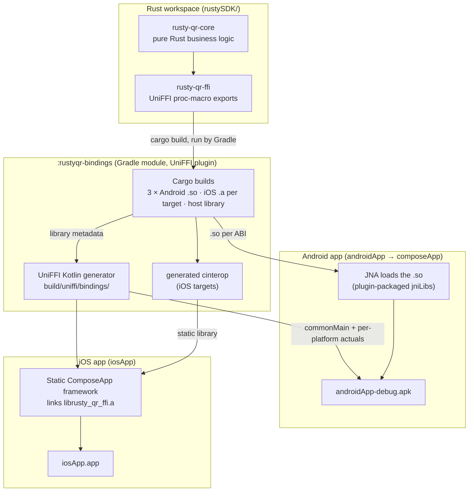
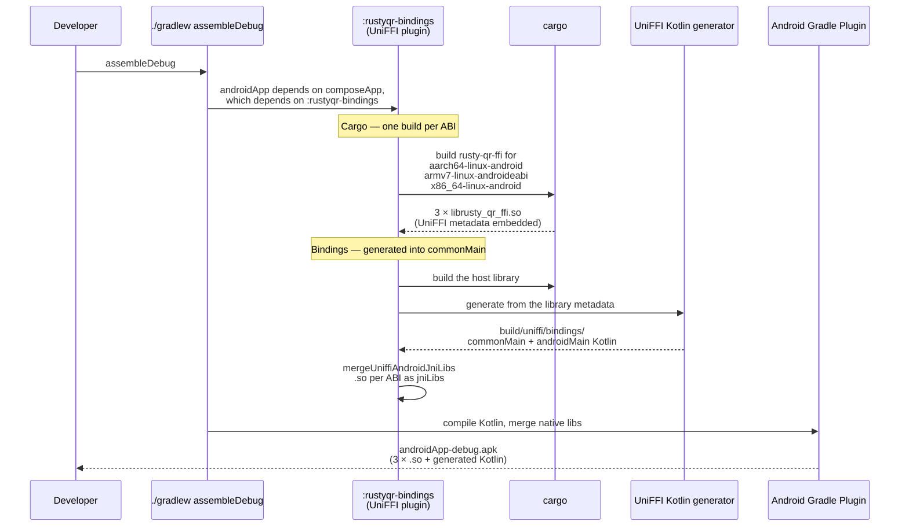
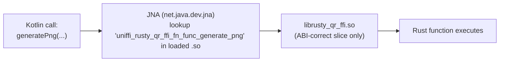
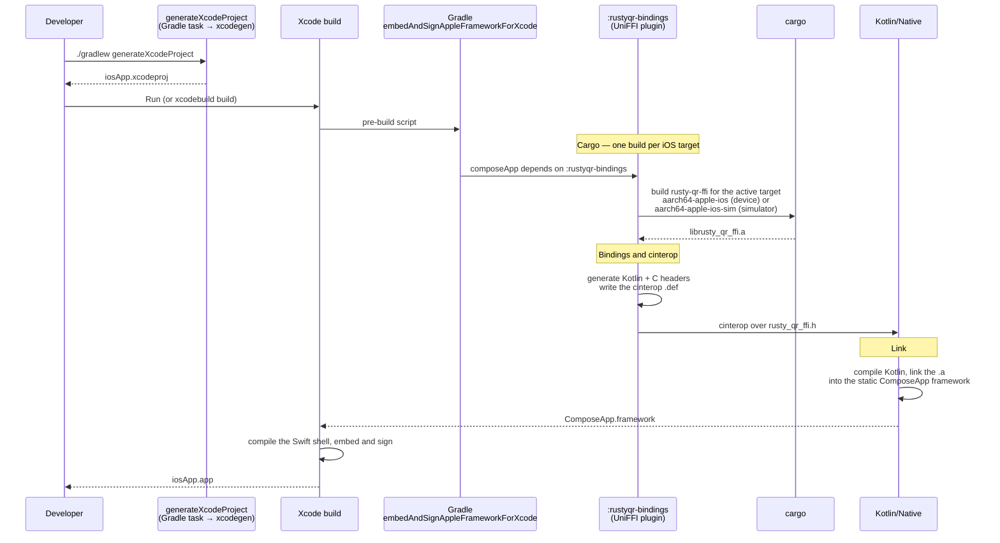
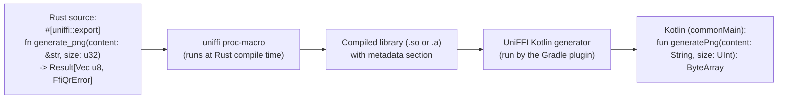
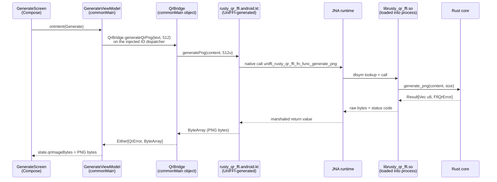
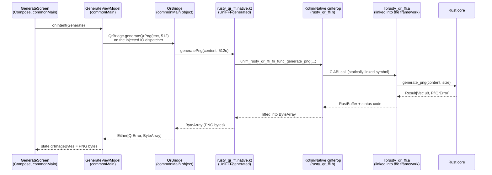

# Rusty-QR — Architecture & Build Pipeline

**Audience:** anyone who wants to understand how one Rust codebase becomes two native apps.

This is the deep dive. It walks the full path from a `.rs` source file to a QR code rendered on a
phone, with sequence diagrams for every non-trivial step. Start at the top and read front-to-back;
every section builds on the previous one.

Sibling docs:

- [Root README](../README.md) — product overview, screenshots, feature list
- [`composeApp/README.md`](../composeApp/README.md) — KMP module reference (shared Compose UI, MVI, `bridge/` pattern)
- [`composeApp/src/androidMain/README.md`](../composeApp/src/androidMain/README.md) — Android actuals + build pipeline
- [`iosApp/README.md`](../iosApp/README.md) — iOS Xcode project reference
- [`rustySDK/README.md`](../rustySDK/README.md) — Rust crate reference

---

## Table of Contents

1. [The Big Picture](#the-big-picture)
2. [Why Not a Separate AAR or `.framework`?](#why-not-a-separate-aar-or-framework)
3. [The Shared Foundation — Rust + UniFFI](#the-shared-foundation--rust--uniffi)
4. [The `:rustyqr-bindings` Module — Gradle Runs Cargo](#the-rustyqr-bindings-module--gradle-runs-cargo)
5. [Android Branch — `.rs` to installable APK](#android-branch--rs-to-installable-apk)
6. [iOS Branch — `.rs` to a linked Kotlin framework](#ios-branch--rs-to-a-linked-kotlin-framework)
7. [UniFFI Metadata — How Bindings Stay in Sync](#uniffi-metadata--how-bindings-stay-in-sync)
8. [Runtime — What Happens When the App Calls Rust](#runtime--what-happens-when-the-app-calls-rust)
9. [Type Mapping Across the FFI Boundary](#type-mapping-across-the-ffi-boundary)
10. [Glossary — Files and Formats](#glossary--files-and-formats)

---

## The Big Picture

One Rust workspace produces native libraries for two platforms. The Kotlin bindings that call those
libraries are **auto-generated** from the Rust source into `commonMain` — no hand-written JNI, no C
bridging headers, and no Swift binding layer. A Gradle module, `:rustyqr-bindings`, drives the whole
chain: it runs Cargo, runs the UniFFI generator and hands the results to `composeApp`.



The key insight: **both platforms consume the same Rust source and the same generated Kotlin API**.
Only the way the native library is loaded differs.

---

## Why Not a Separate AAR or `.framework`?

The Rust library is built, packaged and consumed inside this repository, so nothing needs to be
published or hand-assembled.

### Android: the `.so` files travel inside the bindings module

`:rustyqr-bindings` is an Android library module (it applies the Android KMP library plugin). The
UniFFI Gradle plugin builds one `librusty_qr_ffi.so` per ABI and packages them as that module's
`jniLibs`. The Android Gradle Plugin merges them into the APK of `androidApp`. There is no
`composeApp/src/androidMain/jniLibs/` directory and nothing to copy by hand.

You would only need to publish an AAR if you wanted to share the Rust library through Maven with
other apps. This is a single-app project, so that does not apply.

### iOS: no packaged Rust artifact, the static library is linked into the Kotlin framework

iOS does not need a packaged Rust artifact. The plugin builds `librusty_qr_ffi.a` for the target Xcode is building
(device or simulator) and generates a Kotlin/Native cinterop definition that points at it. The Kotlin
linker pulls the static library into the `ComposeApp` framework, so the one static framework that
Xcode embeds already contains the Rust code.

```
Android flow:  Gradle runs cargo for 3 ABIs  →  3 × .so (plugin jniLibs)  →  AGP packages into the APK
iOS flow:      Gradle runs cargo for the active target  →  .a  →  cinterop links it into the ComposeApp framework
```

---

## The Shared Foundation — Rust + UniFFI

Both branches start from the same place: the `rusty-qr-ffi` crate, which wraps `rusty-qr-core` and
annotates every public function with a UniFFI macro.

```rust
// rustySDK/crates/ffi/src/lib.rs
#[uniffi::export]
fn generate_png(content: &str, size: u32) -> Result<Vec<u8>, FfiQrError> {
    rusty_qr_core::encoder::generate_png(content, size).map_err(FfiQrError::from)
}
```

The `#[uniffi::export]` macro does two things at compile time:

1. Makes the function callable from C (the common substrate underneath both Kotlin/JNA and
   Kotlin/Native cinterop).
2. Embeds a **metadata record** into the compiled binary describing the function's signature.

That metadata is how the UniFFI generator later emits matching Kotlin code without you writing
bridging boilerplate. More on that in
[UniFFI Metadata](#uniffi-metadata--how-bindings-stay-in-sync).

### Crate layout

```
rustySDK/
├── Cargo.toml                 # workspace definition
└── crates/
    ├── core/                  # pure Rust — no FFI, no UniFFI
    ├── ffi/                   # UniFFI exports + type wrappers (cdylib + staticlib)
    └── wasm/                  # wasm-bindgen exports for the browser demo (cdylib + rlib)
```

There is no binding-generator crate in the workspace. The generator is built and run by the Gradle
plugin.

The `ffi` crate declares **two** library types:

```toml
[lib]
crate-type = ["cdylib", "staticlib"]
```

| Output      | Format                | Used by                                                          |
|-------------|-----------------------|------------------------------------------------------------------|
| `cdylib`    | `.so` (Android) / `.dylib` (host) | Android — loaded at runtime via JNA; the host library backs the JVM tests |
| `staticlib` | `.a` (static archive) | iOS — linked into the Kotlin framework at link time              |

One source, two output formats. The Android build asks for `cdylib`; the iOS build asks for
`staticlib`.

### The `wasm` crate and the web demo

`rustySDK/crates/wasm` is a third consumer of `core`, next to `ffi`. It is not part of the mobile
build pipeline: Gradle does not build it and neither app links it. Like `ffi`, it holds no logic; each
function delegates to `core` in one expression. It targets `wasm32-unknown-unknown` with `wasm-bindgen`
and exports:

| JavaScript export            | Rust core call                 | Returns                    |
|------------------------------|--------------------------------|----------------------------|
| `generatePng(content, size)` | `encoder::generate_png`        | PNG bytes (`Uint8Array`)   |
| `decodeImage(bytes)`         | `decoder::decode`              | the QR content (`string`)  |
| `libraryVersion()`           | `encoder::get_library_version` | the core version (`string`) |

Core errors become JavaScript `Error` objects carrying the core's message. The crate builds as
`cdylib` (the wasm module) plus `rlib` so `tests/web.rs` can link it.

The demo in `web/rust-demo/` (`index.html`, `main.js`) imports the generated package from
`rustySDK/crates/wasm/pkg/` (gitignored). Build, test and serve it with:

```bash
wasm-pack test --headless --chrome rustySDK/crates/wasm
wasm-pack build rustySDK/crates/wasm --target web --release
python3 -m http.server 8000     # from the repo root, then open http://localhost:8000/web/rust-demo/
```

Serve over HTTP rather than opening the file, because browsers block ES module imports from `file://`.
This build uses `wasm-pack` directly instead of a Gradle task, because it is outside the mobile app
build. Without `--with-wasm`, `scripts/bootstrap.sh` only warns when `wasm-pack` or the
`wasm32-unknown-unknown` target is missing.

---

## The `:rustyqr-bindings` Module — Gradle Runs Cargo

`rustyqr-bindings/build.gradle.kts` applies the Ubique UniFFI Gradle plugin
(`ch.ubique.uniffi.plugin`, version in `gradle/libs.versions.toml`) and points it at the FFI crate:

```kotlin
cargo {
    packageDirectory = rootProject.layout.projectDirectory.dir("rustySDK/crates/ffi")
}

uniffi {
    generateFromLibrary {
        packageName = "com.p2.apps.rustyqr.rust"
    }
}
```

`composeApp` depends on this module (`implementation(project(":rustyqr-bindings"))`), so building
either app builds Rust first. The plugin registers these tasks, among others (`./gradlew tasks --all`
lists them):

| Task                                        | What it does                                                          |
|---------------------------------------------|-----------------------------------------------------------------------|
| `:rustyqr-bindings:cargoBuild…Debug`        | One task per target triple: runs Cargo on `rustySDK/crates/ffi`        |
| `:rustyqr-bindings:buildLibraryForBindings` | Selects the built host library whose metadata the generator reads     |
| `:rustyqr-bindings:buildBindings`           | Runs the generator; writes `rustyqr-bindings/build/uniffi/bindings/`   |
| `:rustyqr-bindings:mergeUniffiAndroidJniLibs` | Collects the `.so` files per ABI for the Android library            |
| `:rustyqr-bindings:cinteropUniffi-cinterop…`  | iOS only: cinterop over the generated C header and the `.a`         |

### Build profiles

- **Debug** builds use Cargo's `dev` profile. `rustySDK/Cargo.toml` optimises the dependencies
  (`image`, `rqrr`, `qrcode`, and `rusty-qr-core` itself), so debug builds still scan at a realistic
  speed. Debug builds cover all three Android ABIs, listed in `androidAbis` in `gradle.properties`.
- **Release** builds need `-PreleaseBuild=true`. Xcode adds the flag for every configuration except
  Debug. `composeApp` has a `verifyReleaseRustProfile` task, wired into `androidApp` release packaging and the iOS
  release link, that fails without it, so a shipped artifact can never embed the debug Rust library.
- **NDK:** the plugin uses the newest NDK under the Android SDK. Pin one with
  `-PndkVersion=<version>`.

### What the generated bindings look like

The generator writes Kotlin into `rustyqr-bindings/build/uniffi/bindings/` (gitignored, regenerated
on demand):

```
rustyqr-bindings/build/uniffi/bindings/
├── commonMain/      # expect declarations, data classes, FfiQrException, enums
├── androidMain/     # actuals that call the .so through JNA
├── nativeMain/      # actuals for iOS that call the C functions through cinterop
├── jvmMain/         # actuals for host JVM tests
└── nativeInterop/   # C headers consumed by the generated cinterop definition
```

The generated API is a single `commonMain` surface (`generatePng`, `decodeQr`, `decodeQrFromRaw`,
`generateWithConfig`, `getLibraryVersion`, `contentFits`, `FfiQrConfig`, `FfiScanResult`,
`FfiQrException`, `FfiQrErrorCorrection`) with one `actual` per platform.
`composeApp/src/commonMain/.../bridge/QrBridge.kt` is a plain `object` over that API: it calls the
generated functions and maps `FfiQrException` to the app's `Either<QrError, T>`. It is not an
`expect`, and it has no platform actuals.

> **Stale checkouts.** An older checkout may still have `composeApp/src/androidMain/jniLibs/` and
> `composeApp/src/androidMain/kotlin/generated/` on disk from the previous build pipeline. Gradle
> would package or compile them next to the new output, so delete both directories.

---

## Android Branch — `.rs` to installable APK

The Android pipeline is driven by one Gradle command: `./gradlew :androidApp:assembleDebug`.



### Why three `.so` files but one generated Kotlin API?

- **Three `.so` files** — each Android CPU architecture (arm64, arm32, x86_64) needs its own
  machine code. At install time the device only keeps the `.so` matching its CPU.
- **One Kotlin API** — the generated Kotlin calls Rust functions *by name* through JNA at runtime.
  The name resolution happens against whichever `.so` was loaded, so the Kotlin code is
  architecture-independent. The UniFFI metadata is identical in every `.so`, so one library is
  enough as the generator's input.

### Where the `.so` files end up

```
rustyqr-bindings/build/generated/jniLibs/mergeUniffiAndroidJniLibs/
├── arm64-v8a/librusty_qr_ffi.so       # most modern phones
├── armeabi-v7a/librusty_qr_ffi.so     # legacy 32-bit ARM
└── x86_64/librusty_qr_ffi.so          # Mac-hosted emulators
```

`androidApp` sets `abiFilters` to the same three ABIs, so another ABI that a dependency ships
cannot install and then crash for lack of a Rust library. The two 64-bit ABIs (`arm64-v8a`, `x86_64`) are linked with 16KB ELF page
alignment (LOAD `align 0x4000`), which is what Android's November 2025 requirement covers; NDK 28+
does that automatically. `armeabi-v7a` stays at 4KB (`0x1000`), because the NDK aligns only 64-bit ABIs.

### How JNA loads the `.so` at runtime

The UniFFI-generated Kotlin code calls Rust functions through **JNA** (Java Native Access), not
`System.loadLibrary`. JNA is a runtime library that discovers and calls C functions by name. The
plugin's runtime artifact brings it in, so neither `composeApp` nor `androidApp` declares anything extra:



---

## iOS Branch — `.rs` to a linked Kotlin framework

Xcode runs the iOS pipeline. The generated Xcode project (`iosApp.xcodeproj`, made by XcodeGen from
`iosApp/project.yml`) has a pre-build script that calls Gradle:

```
./gradlew :composeApp:embedAndSignAppleFrameworkForXcode            # Debug
./gradlew :composeApp:embedAndSignAppleFrameworkForXcode -PreleaseBuild=true   # every other configuration
```



There is no packaged Rust artifact, no Swift binding file and no module map. The Swift shell in `iosApp/iosApp/`
only hosts `mainViewController()` from the Kotlin framework; all calls into Rust happen in Kotlin.

### Why XcodeGen?

Xcode's native project format (`.pbxproj`) is opaque XML full of random UUIDs that change on every
save. It's unreviewable in PRs and produces constant merge conflicts.

**XcodeGen** solves this by treating `.xcodeproj` as a *generated artifact* — you edit a
human-readable YAML file (`iosApp/project.yml`) and run `xcodegen generate` to rebuild the project
file. The `.xcodeproj` is gitignored; `project.yml` is the source of truth.

### How Xcode picks up the Rust code

Two `project.yml` details wire everything together:

1. **The pre-build script** runs `embedAndSignAppleFrameworkForXcode`, which builds the Rust
   library, the bindings and the `ComposeApp` framework for the active destination (device or
   simulator).
2. **The release flag** — the script passes `-PreleaseBuild=true` for every configuration except
   Debug, so shipped builds embed the optimised Rust library.

---

## UniFFI Metadata — How Bindings Stay in Sync

Both branches depend on a crucial magic trick: UniFFI embeds a description of every exported
function *into* the compiled binary. The generator reads that description back out to produce the
Kotlin code.



### What this buys you

1. **No drift.** Change a Rust function signature, rebuild, and the Kotlin regenerates to match. If
   the bindings are out of sync with Rust, you'll get a *compile* error in the app, not a runtime
   crash.
2. **No hand-written JNI or C headers.** The whole "how do I call Rust from Kotlin?" problem is
   solved by code generation.
3. **Idiomatic output.** UniFFI emits `data class`es, enum classes and sealed exceptions with typed
   variants. It feels native in Kotlin.

### Where bindings land

| Source set   | Generated file(s)                                                              | Lives in                                                      |
|--------------|--------------------------------------------------------------------------------|---------------------------------------------------------------|
| commonMain   | `rusty_qr_ffi.common.kt`                                                       | `rustyqr-bindings/build/uniffi/bindings/commonMain/kotlin/com/p2/apps/rustyqr/rust/` |
| androidMain  | `rusty_qr_ffi.android.kt`                                                      | `rustyqr-bindings/build/uniffi/bindings/androidMain/kotlin/…` |
| nativeMain   | `rusty_qr_ffi.native.kt` + C headers for cinterop                              | `rustyqr-bindings/build/uniffi/bindings/nativeMain/` and `nativeInterop/` |

All of it sits under `rustyqr-bindings/build/`, which is **gitignored**. `./gradlew
:rustyqr-bindings:buildBindings` regenerates it, and every build that needs it runs that task.

---

## Runtime — What Happens When the App Calls Rust

The build-time story above gets you a binary with everything wired up. Here's the runtime story
for a single QR generation call, on both platforms:

### Android



### iOS



The key difference: on Android JNA does a **runtime** symbol lookup into a dynamically loaded
`.so`; on iOS the symbol is resolved at **link time** because the `.a` was statically linked into
the framework. Kotlin/Native cinterop consumes the UniFFI-generated C header directly — no Swift
round-trip. Everything above the generated bindings is identical — same Compose UI, same
ViewModel, same `QrBridge` object.

---

## Type Mapping Across the FFI Boundary

UniFFI converts between Rust types and Kotlin types automatically. The FFI wrapper types (`Ffi*`)
exist because the core crate deliberately has no UniFFI dependency — the wrapper crate adds the
annotations and does the conversion. The Kotlin column lists the types in
`rustyqr-bindings/build/uniffi/bindings/commonMain`.

| Rust (core)         | Rust (ffi wrapper)     | Kotlin (generated)                  |
|---------------------|------------------------|-------------------------------------|
| `QrErrorCorrection` | `FfiQrErrorCorrection` | `FfiQrErrorCorrection` (enum class) |
| `QrConfig`          | `FfiQrConfig`          | `FfiQrConfig` (data class)          |
| `ScanResult`        | `FfiScanResult`        | `FfiScanResult` (data class)        |
| `QrError`           | `FfiQrError`           | `FfiQrException` (sealed class)     |
| `Vec<u8>` / `&[u8]` | `Vec<u8>` / `&[u8]`    | `ByteArray`                         |
| `String` / `&str`   | `String` / `&str`      | `String`                            |
| `u32`               | `u32`                  | `UInt`                              |

Conversion flow:

- **Inputs** (app → Rust): `FfiQrConfig` → `QrConfig` via `From` impls in the `ffi` crate.
- **Outputs** (Rust → app): `ScanResult` → `FfiScanResult` via `From` impls in the `ffi` crate.
- **Errors**: `QrError` → `FfiQrError` → `FfiQrException`. `QrBridge` maps the exception to the
  app's `QrError` inside an `Either`. The variants include `ContentTooLong`, which Rust raises for
  generate input over the encoder's capacity, which depends on the content's mode (numeric,
  alphanumeric, byte); the `content_fits` export (`contentFits()` in Kotlin) reports whether
  content fits, using the same code path as generation.

---

## Glossary — Files and Formats

| Term              | What it is                                                                                            |
|-------------------|-------------------------------------------------------------------------------------------------------|
| `.rs`             | Rust source file                                                                                      |
| `.so`             | Shared object — a dynamically loaded library on Linux/Android                                         |
| `.a`              | Static archive — a bundle of object files linked directly into another binary at compile time        |
| `cdylib`          | Cargo crate type that produces a `.so` / `.dylib` (C-compatible dynamic library)                      |
| `staticlib`       | Cargo crate type that produces a `.a` (C-compatible static archive)                                   |
| `jniLibs`         | Android Gradle Plugin convention — any `.so` in a `jniLibs/<abi>/` tree is auto-packaged into the APK. The UniFFI plugin fills it for `:rustyqr-bindings` |
| AAR               | Android Archive — zipped library artifact (classes + resources + `.so`). **Not published from this repo.** |
| cinterop          | Kotlin/Native tool that turns a C header (and a static library) into a Kotlin API. The UniFFI plugin generates the definition |
| `.xcodeproj`      | Xcode project bundle (directory). Gitignored here — regenerated from `project.yml` by XcodeGen        |
| `project.yml`     | XcodeGen's human-readable project spec — the source of truth for `.xcodeproj`                         |
| `project.pbxproj` | Opaque XML file inside `.xcodeproj` — auto-generated, never edited by hand                            |
| UniFFI            | Mozilla's tool that auto-generates foreign-language bindings from annotated Rust code                 |
| Ubique UniFFI plugin | Gradle plugin (`ch.ubique.uniffi.plugin`) that runs Cargo, runs the generator and wires the output into a KMP module |
| JNA               | Java Native Access — runtime library that lets Kotlin/Java call C functions in a `.so` by name        |
| NDK               | Android's Native Development Kit — the C/C++ toolchain bundled with Android Studio                    |

---

## Further Reading

External resources that go deeper on each piece of the pipeline. Grouped by topic so you can
follow only the threads you care about.

### UniFFI and Rust-to-mobile FFI

- **[Mozilla UniFFI user guide](https://mozilla.github.io/uniffi-rs/)** — the canonical reference.
  Start with "Tutorial" for the end-to-end mental model, then dip into "Udl" (legacy) or
  "Proc-macro" (what this repo uses) depending on the style you're reading in the wild.
- **[Introducing UniFFI (Mozilla Hacks)](https://hacks.mozilla.org/2021/01/announcing-uniffi-cross-platform-component-interfaces/)**
  — the original announcement post. Short, explains *why* Mozilla built it and what problem it
  solves for the Firefox/Application Services team.
- **[Mozilla Application Services — Rust architecture](https://mozilla.github.io/application-services/book/design/megazords.html)**
  — the "megazord" pattern. Real-world production deployment of UniFFI across Firefox iOS,
  Android, and Desktop. Useful if you're curious how this scales to many crates.
- **[ssokolow — Rust FFI cheatsheet](https://web.archive.org/web/20230324134226/https://blog.ssokolow.com/archives/2017/05/17/rust-ffi-a-quick-hello-world-with-python/)**
  — old but still correct primer on the raw mechanics under any FFI library, including UniFFI.

### Rust crate types (`cdylib`, `staticlib`, `rlib`)

- **[The Cargo Book — linkage](https://doc.rust-lang.org/reference/linkage.html)** — the
  authoritative list of crate types and what each produces. Read the table once and bookmark it.
- **[Rust FFI: Producing Shared Libraries from Rust](https://users.rust-lang.org/t/what-is-the-difference-between-dylib-and-cdylib/28847)**
  — the classic forum thread explaining `dylib` vs. `cdylib` vs. `staticlib`. Short, opinionated,
  correct. If you only read one thing to understand why `cdylib` matters for `.so` output, read
  this.
- **[Jake Goulding — Rust FFI Omnibus](http://jakegoulding.com/rust-ffi-omnibus/)** — worked
  examples of calling Rust from C, Ruby, Python, Haskell, and more. Doesn't cover Kotlin/Swift
  directly, but the mental model transfers 1:1.

### Android NDK and JNI-adjacent patterns

- **[Android NDK docs — ABI management](https://developer.android.com/ndk/guides/abis)** — the
  definitive guide to `arm64-v8a`, `armeabi-v7a`, `x86_64`, and why you need multiple slices.
- **[Android's 16KB page size requirement](https://developer.android.com/guide/practices/page-sizes)**
  — why NDK 28+ matters. Mandatory reading before
  shipping to the Play Store in late 2025.
- **[JNA vs. JNI — when and why](https://github.com/java-native-access/jna/blob/master/www/Frequently%20Asked%20Questions.md)**
  — the JNA FAQ. Explains the tradeoff we take by going through JNA instead of writing hand-rolled
  JNI glue. UniFFI's generated Kotlin assumes JNA; this is the "why".

### Kotlin/Native interop and the UniFFI Gradle plugin

- **[Kotlin/Native — interoperability with C](https://kotlinlang.org/docs/native-c-interop.html)**
  — how a C header and a static library become a Kotlin API. The plugin generates the `.def` file
  that this page describes.
- **[Ubique — uniffi-kotlin-multiplatform-bindings](https://github.com/UbiqueInnovation/uniffi-kotlin-multiplatform-bindings)**
  — the Gradle plugin this repo uses (`ch.ubique.uniffi.plugin`): its README documents the `cargo { }`
  and `uniffi { }` blocks and the generated source layout.

### XcodeGen and `.xcodeproj` generation

- **[XcodeGen README](https://github.com/yonaskolb/XcodeGen)** — the project itself, with a full
  `project.yml` schema. Start here.
- **[XcodeGen project specification](https://github.com/yonaskolb/XcodeGen/blob/master/Docs/ProjectSpec.md)**
  — every knob you can turn. Keep this open in a tab while editing `project.yml`.
- **[Why we moved to XcodeGen (The Kickstarter Engineering blog)](https://kickstarter.engineering/why-we-moved-to-xcodegen-4a12c0e12a23)**
  — the "why bother" post. Explains the merge-conflict pain that `.xcodeproj` + multiple
  engineers causes and why generating it from YAML fixes it.

### Kotlin Multiplatform specifics

- **[KMP official docs — expect/actual](https://kotlinlang.org/docs/multiplatform-expect-actual.html)**
  — the language-level mechanism this repo uses for platform bridges. Worth re-reading even if
  you've used it before.
- **[Touchlab's KMP guides](https://touchlab.co/category/kmm/)** — the most production-focused
  KMP content on the internet. Their posts on Kotlin/Native memory model, Objective-C interop,
  and CI setups are excellent.
- **[JetBrains — Compose Multiplatform guides](https://www.jetbrains.com/help/kotlin-multiplatform-dev/compose-multiplatform-getting-started.html)**
  — for the UI half of the stack. Pair with the KMP docs above.

### The bigger picture — cross-platform mobile architecture

- **[Dropbox — Why we use Rust (engineering blog)](https://dropbox.tech/infrastructure/rewriting-the-heart-of-our-sync-engine)**
  — a war story on rewriting a sync engine in Rust, including the mobile FFI story.
- **[Signal — Rust iOS/Android FFI](https://signal.org/blog/asynchronous-security/)** — how
  Signal uses Rust for cryptography primitives across mobile. Architecture post rather than a
  tutorial, but gives you a sense of what "production" looks like.
- **[1Password — Rust at 1Password](https://blog.1password.com/how-we-use-rust-in-1password/)**
  — similar territory; useful for comparing architectural choices across teams that picked the
  same stack.

### Video (if you'd rather watch than read)

- **[Jon Gjengset — Crust of Rust: FFI](https://www.youtube.com/watch?v=pePqWoTnSmQ)** — one of
  the clearest video walkthroughs of Rust FFI fundamentals. Two hours; worth every minute if
  you're new to the topic.

> **Tip.** If this is your first time through the pipeline, read in this order: Rust crate types
> → UniFFI tutorial → Android NDK ABI guide → Kotlin/Native C interop. That mirrors the order
> of the build pipeline itself, so each new piece lands on top of context you already have.

---

**Next:** jump into the platform-specific READMEs for build commands and troubleshooting:
[Android](../composeApp/src/androidMain/README.md) · [iOS](../iosApp/README.md) · [Rust SDK](../rustySDK/README.md).
For shared KMP conventions, see [`composeApp/README.md`](../composeApp/README.md).
