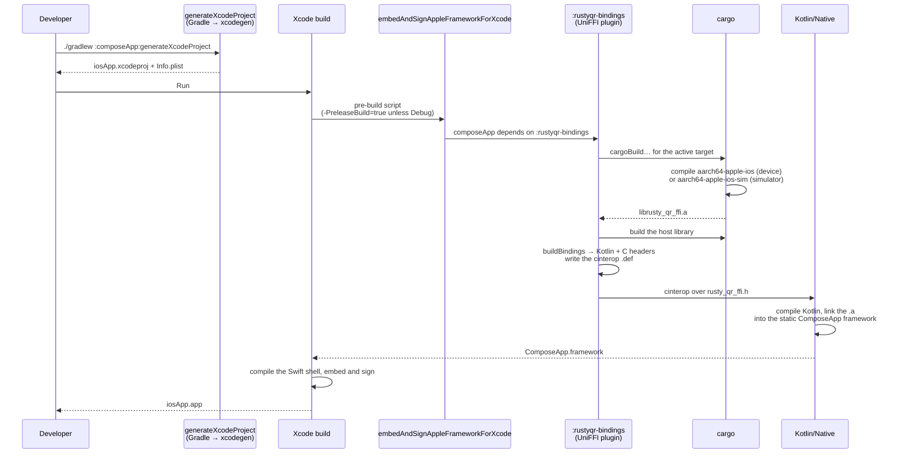
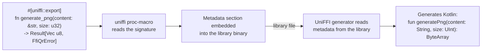

<div align="center">

# iosApp — iOS Xcode Project

### Thin UIKit shell. Compose UI through SKIA. Rust linked into the Kotlin framework.

<p>
  
  
  
  
  
</p>

<p><b>Rust <code>.a</code> · Kotlin bindings · cinterop · static <code>ComposeApp</code> framework — Gradle builds all four when Xcode builds</b></p>

<sub>The iOS side has no native SwiftUI screens. <code>ContentView.swift</code> wraps the Compose UI exported from <code>iosMain</code>; everything else on screen is shared Kotlin.</sub>

</div>

---

> **Want the full pipeline end-to-end with sequence diagrams?**
> See [**`docs/ARCHITECTURE.md`**](../docs/ARCHITECTURE.md) — the single source of truth for how
> Rust becomes two native apps (both Android and iOS branches, runtime call paths, UniFFI deep dive).
>
> For cross-platform architecture, MVI, and shared UI, see the [top-level README](../README.md)
> and the [KMP module README](../composeApp/README.md). The Android pipeline lives in
> [`composeApp/src/androidMain/README.md`](../composeApp/src/androidMain/README.md); the Rust
> engine is documented in [`rustySDK/README.md`](../rustySDK/README.md).

---

## What's in the Box

| Piece                                                         | State            |
|---------------------------------------------------------------|------------------|
| Rust `.a` for `aarch64-apple-ios` + `aarch64-apple-ios-sim`   | Built by Gradle  |
| UniFFI Kotlin bindings (`commonMain` + native actual)         | Generated        |
| cinterop over the UniFFI C header, linking the `.a`           | Generated        |
| `iosApp.xcodeproj` generated from `project.yml`               | Yes              |
| Shared Compose UI hosted via `MainViewController`             | Wired            |
| `iosMain` hardware bridges (camera, haptics, URL, permission) | Implemented      |
| `QrBridge` → Rust through the generated bindings              | One `commonMain` object |

Kotlin/Native consumes the UniFFI-generated C header directly via cinterop — no Swift round-trip,
and no Swift bindings exist. The Swift in `iosApp/` is only the shell that hosts the Compose view
controller.

---

## Quick Start

```bash
# First-time setup — verifies Xcode 26.x, xcodegen, swiftlint, swiftformat,
# Rust toolchain, iOS Rust targets; prompts to install what's missing
./scripts/bootstrap.sh

# Generate the Xcode project from project.yml
./gradlew :composeApp:generateXcodeProject

# Open in Xcode and run the iosApp scheme
open iosApp/iosApp.xcodeproj
```

Or build from the command line (list simulators with `xcrun simctl list devices available`):

```bash
xcodebuild build -project iosApp/iosApp.xcodeproj -scheme iosApp \
  -destination 'platform=iOS Simulator,name=<simulator name>'
```

The Xcode build runs a pre-build script that calls Gradle, which builds the Rust static library,
generates the bindings and links the `ComposeApp` framework. The first build takes several minutes
(it also compiles the UniFFI Kotlin generator with `cargo install`); later builds reuse the
results. For manual or CI `xcodebuild` runs, do not set `OVERRIDE_KOTLIN_BUILD_IDE_SUPPORTED`: the
Kotlin framework must be compiled and linked. Android Studio sets it to `YES` on purpose, so the
script exits early and the IDE runs the Gradle task itself.

---

<details>
<summary><b>iOS Layout</b> — directory map and where the iOS actuals live</summary>

<br/>

```
iosApp/
├── project.yml                   # XcodeGen spec — source of truth for the Xcode project
├── iosApp.xcodeproj/             # GENERATED by XcodeGen — gitignored
│
└── iosApp/
    ├── iOSApp.swift              # @main SwiftUI App (struct IOSApp) — hosts ContentView
    ├── ContentView.swift         # UIViewControllerRepresentable wrapping mainViewController()
    ├── Info.plist                # GENERATED by XcodeGen — gitignored (NSCameraUsageDescription + app config)
    └── Assets.xcassets/          # App icon, accent color
```

The Rust library and its bindings are not in this directory. They belong to the `:rustyqr-bindings`
Gradle module and live under `rustyqr-bindings/build/` and `rustySDK/target/` (both gitignored).

The iOS side has **no native SwiftUI screens**. `ContentView.swift` is a
`UIViewControllerRepresentable` that wraps `MainViewControllerKt.mainViewController()` — the
Compose UI exported from the KMP `iosMain` source set. Every screen (scan, generate, result sheet)
runs as Compose rendered through SKIA on iOS.

The iOS Kotlin/Native actuals live under
`composeApp/src/iosMain/kotlin/com/p2/apps/rustyqr/bridge/`:

```
composeApp/src/iosMain/kotlin/com/p2/apps/rustyqr/
├── MainViewController.kt         # fun mainViewController(): UIViewController { ComposeUIViewController { App() } }
├── Platform.ios.kt
└── bridge/
    ├── CameraPreview.ios.kt      # actual — AVFoundation via UIKitView
    ├── CameraPermission.ios.kt   # actual — AVCaptureDevice.requestAccess
    ├── HapticFeedback.ios.kt     # actual — UIImpactFeedbackGenerator
    ├── OpenUrl.ios.kt            # actual — UIApplication.openURL
    ├── PlainTextClipEntry.ios.kt # actual — ClipEntry for plain text
    ├── ShareQrImage.ios.kt       # actual — UIActivityViewController
    ├── SaveQrImage.ios.kt        # actual — PHPhotoLibrary
    └── ImageDecoder.ios.kt       # actual — UIImage → ImageBitmap
```

There is no `QrBridge.ios.kt`. `QrBridge` is one `commonMain` object over the generated bindings, and
the generated `nativeMain` actual (in `rustyqr-bindings`) does the cinterop calls.

</details>

<details>
<summary><b>iOS Build Pipeline</b> — from Rust source to an Xcode-ready project</summary>

<br/>

Kotlin can't call Rust directly — they're different languages. Three things need to happen:

1. **Compiled Rust libraries** (`.a` static archives) for the device and the simulator
2. **Generated Kotlin code** that knows how to call the functions inside the Rust library
3. **A link step** that pulls the `.a` into the Kotlin framework Xcode embeds

The `:rustyqr-bindings` module does all three, through the Ubique UniFFI Gradle plugin
(`ch.ubique.uniffi.plugin`). The Xcode project's pre-build script calls Gradle, so building in
Xcode is the only command you run. There is no script to run by hand (`rustySDK/Makefile` only
wraps the Rust checks: `make test`).

### The Xcode pre-build script

`iosApp/project.yml` defines a "Compile Kotlin Framework" pre-build script. It runs from the
repository root:

```bash
# Debug configuration:
./gradlew :composeApp:embedAndSignAppleFrameworkForXcode
# every other configuration:
./gradlew :composeApp:embedAndSignAppleFrameworkForXcode -PreleaseBuild=true
```

`embedAndSignAppleFrameworkForXcode` builds the `ComposeApp` framework for the platform and
architecture Xcode asks for, and embeds it into the app. Only the `-PreleaseBuild=true` flag
selects the optimised Rust library; `verifyReleaseRustProfile` fails a release link without it.

### What the plugin does

**1. Cross-compile Rust.** One `cargoBuild…Debug` (or release) task per target runs Cargo on
`rustySDK/crates/ffi`. Xcode builds for one destination at a time, so a build compiles only the
target that matches it:

| Target                  | Who uses it                         | Output file                                              |
|-------------------------|-------------------------------------|----------------------------------------------------------|
| `aarch64-apple-ios`     | Physical iPhones and iPads          | `rustySDK/target/aarch64-apple-ios/<profile>/librusty_qr_ffi.a`     |
| `aarch64-apple-ios-sim` | iOS Simulator on Apple Silicon Macs | `rustySDK/target/aarch64-apple-ios-sim/<profile>/librusty_qr_ffi.a` |

The `.a` files are static archives — the iOS equivalent of Android's `.so` files. "Static" means
the library code is copied directly into the final binary at link time. The plugin also builds a
host library, which the generator reads.

**2. Generate Kotlin bindings.** `buildBindings` reads the UniFFI metadata embedded in the host
library and emits Kotlin plus C headers into `rustyqr-bindings/build/uniffi/bindings/`:

```
Rust:    generate_png(content: &str, size: u32) -> Result<Vec<u8>, FfiQrError>
         ↓  UniFFI generator  ↓
Kotlin:  fun generatePng(content: String, size: UInt): ByteArray
         (throws FfiQrException on failure)
```

**3. Generate and run cinterop.** The plugin writes a cinterop `.def` file per iOS target. It names
the C headers, the library path under `rustySDK/target/<triple>/<profile>/` and
`staticLibraries = librusty_qr_ffi.a`. Kotlin/Native turns the C header into a Kotlin API, and the
generated `nativeMain` actual calls it.

**4. Link.** Kotlin/Native links the `.a` into the static `ComposeApp` framework
(`isStatic = true` in `composeApp/build.gradle.kts`). The framework Xcode embeds therefore already
contains the Rust code. There is no separate Rust artifact to add to the Xcode project.

Both device and simulator builds are arm64 only (`ARCHS: arm64` in `project.yml`), which matches
the two Rust targets.

### Regenerating the Xcode project

Gradle owns the Xcode project. `generateXcodeProject` shells out to `xcodegen generate` and bakes
`version.properties` into the project. Nothing in the Rust build touches it. Fresh-clone sync is
handled separately in `settings.gradle.kts`, which runs `xcodegen` before the KMP plugin loads if
the project file is missing. Prerequisite: `brew install xcodegen`.

### Full pipeline



</details>

<details>
<summary><b>XcodeGen Deep Dive</b> — <code>project.yml</code> as source of truth</summary>

<br/>

**XcodeGen** is a command-line tool that generates `.xcodeproj` files from a human-readable YAML
file called `project.yml`.

Xcode stores project config in `.pbxproj` files — opaque auto-generated XML with random UUIDs on
every line. They are impossible to review in pull requests and cause constant merge conflicts when
two developers add files simultaneously.

`project.yml` is the opposite: declarative YAML where every setting is readable and diffs are
meaningful. The `.xcodeproj` becomes a **generated artifact** — like a compiled binary, you never
edit it by hand.

### Key rules

- **`project.yml` is the source of truth** — all project changes go here
- **Never edit `.xcodeproj` directly** — your changes will be overwritten on the next generation
- **`.xcodeproj` is gitignored** — it is regenerated by `./gradlew :composeApp:generateXcodeProject`; `settings.gradle.kts` runs `xcodegen` only when `project.pbxproj` is missing (fresh clone), and a normal build does not regenerate it

### How to regenerate

```bash
./gradlew :composeApp:generateXcodeProject
```

### When to regenerate

- After editing `project.yml`
- After running `./gradlew :composeApp:cleanXcodeProject`
- After bumping `version.properties`
- On a fresh clone (the `.xcodeproj` is not checked in; `settings.gradle.kts` also generates it on the first Gradle run)

### Common `project.yml` operations

**Adding a new Swift file:** just create it in the `iosApp/` directory. XcodeGen auto-discovers
source files via the `sources` path — no project file edit needed.

**Adding a framework dependency:**

```yaml
dependencies:
  - sdk: CoreLocation.framework
```

**Adding a build setting:**

```yaml
settings:
  base:
    MY_SETTING: "value"
```

Full XcodeGen spec: https://github.com/yonaskolb/XcodeGen/blob/master/Docs/ProjectSpec.md

</details>

<details>
<summary><b>How Xcode Picks Up the Rust Code</b> — one wiring point</summary>

<br/>

Xcode itself never sees the Rust library. The only connection is the **pre-build script** in
`project.yml`, which calls `embedAndSignAppleFrameworkForXcode`. Gradle builds the Rust static
library, the bindings and the `ComposeApp` framework, then Xcode embeds the framework into the app.
The Swift shell calls `MainViewControllerKt.mainViewController()` from that framework and nothing
else.

Because the `.a` is linked into the framework, the app needs no Rust entry in "Frameworks,
Libraries, and Embedded Content", no header search path and no module map.

</details>

<details>
<summary><b>UniFFI Metadata Under the Hood</b> — proc-macros embed the signature in the library</summary>

<br/>

The UniFFI generator knows what Kotlin to generate because **proc-macros** in the Rust FFI crate
embed metadata directly into the compiled library at compile time:



Change a Rust function signature and the next Xcode build regenerates the Kotlin to match — no
manual bridging code to keep in sync.

### Why Two `.a` Files but One Kotlin API?

**Two `.a` files** because each platform needs its own machine code. ARM64 code compiled for the
iOS device SDK can't run on the simulator SDK (different system libraries and ABI), even though
both are ARM64.

**One Kotlin API** because the Kotlin code is platform-independent — it calls Rust functions by
name through the C ABI, and the linker resolves those names against whichever `.a` the active
target's cinterop definition names. The UniFFI metadata is identical in every library, so the host
library is enough as the input for binding generation.

</details>

<details>
<summary><b>Fresh-Clone Bootstrap</b> — how Gradle sync survives without a checked-in xcodeproj</summary>

<br/>

The Kotlin Multiplatform Gradle plugin auto-registers `convertPbxprojToJson` whenever iOS targets
are declared. It reads `iosApp.xcodeproj/project.pbxproj` at **configuration time** to wire Embed &
Sign phases. On a fresh clone `project.pbxproj` doesn't exist (it's a generated artifact), so the
plugin would fail validation before any task could regenerate it.

`settings.gradle.kts` handles this in a pre-plugin `run { }` block: if `project.yml` exists and
`project.pbxproj` doesn't, it runs `xcodegen generate` via `providers.exec` (config-cache
compatible) before the KMP plugin loads. No manual step required.

Prerequisite: `brew install xcodegen`. If it's missing, Gradle sync fails with a clear message
pointing to the install command.

</details>

<details>
<summary><b>First-Time Setup & Cleaning</b> — one-off install and full reset</summary>

<br/>

### First-Time Setup

```bash
# 1. Rust
curl --proto '=https' --tlsv1.2 -sSf https://sh.rustup.rs | sh

# 2. iOS cross-compilation targets
rustup target add aarch64-apple-ios aarch64-apple-ios-sim

# 3. XcodeGen
brew install xcodegen

# 4. Generate the Xcode project (the Rust build happens inside the Xcode build)
./gradlew :composeApp:generateXcodeProject

# Open in Xcode
open iosApp/iosApp.xcodeproj
```

`./scripts/bootstrap.sh` checks all of this. Xcode must be 26.x.

### Cleaning Up

```bash
./gradlew :composeApp:cleanXcodeProject                # generated Xcode project + Info.plist
./gradlew :rustyqr-bindings:clean :composeApp:clean    # generated bindings, cinterop output, frameworks
cd rustySDK && cargo clean                             # Cargo build output (rustySDK/target/)
```

Then regenerate the project and rebuild:

```bash
./gradlew :composeApp:generateXcodeProject
```

</details>
